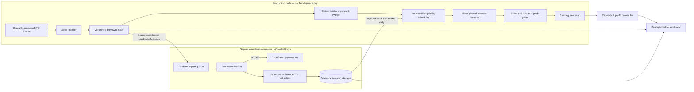

# Copper Jev Liquidation Watchlist — Implementation-Ready Rust Architecture and Development Plan

**Revision:** 1.0 · **Research checked:** 2026-10-12 · **Target:** Arbitrum One (chain ID 42161), Aave V3 market · **Implementation language:** Rust · **Deployment:** rootless Podman first, Docker Compose compatible · **Initial state:** design/handoff; no changes have been made to the existing bot.

## 0. Operating contract and nonnegotiable invariants

**Goal:** reduce monitoring/simulation workload for Aave V3 borrowers *without* decreasing the discovery of financially actionable liquidations. Jev is a hosted, advisory classification/ranking primitive. Its output is never proof of Aave liquidation eligibility, profit, oracle accuracy, or transaction safety.

**Invariants:**

1. **No Jev on hot path.** Market-feed ingestion, urgent borrower rechecks, REVM simulation, fee selection, nonce management, and transaction submission never await Jev.
2. **No veto authority.** Jev may rank discretionary checks only. It cannot delete a borrower, mark one safe, suppress oracle/debt-event rechecks, lower an account's deterministic safety tier, or authorize a trade.
3. **Bounded monitoring coverage.** Every tracked active borrower gets a deterministic maximum recheck age, and relevant reserve/oracle changes trigger additional rechecks; expiry is enforced even if Jev is down.
4. **Deterministic execution.** Eligibility and close-factor rules come from verified Aave deployment code and state; REVM must simulate the *exact calldata* on a state-consistent snapshot. Post-simulation change invalidates or triggers fresh simulation.
5. **Versioned inputs.** Every ranking request and response carries a snapshot state revision, chain, market, policy version, feature-schema version, model ID, and expiration. Discard stale/out-of-order replies.
6. **Fail-open for monitoring, fail-closed for trading.** When Jev or telemetry is unavailable, monitor with the deterministic baseline. If chain state, profitability, REVM result, or execution guards are uncertain, do not submit.
7. **Isolation.** Advisor has read-only snapshot access, writes only to advisory result storage, has no signing keys, no wallet RPC privileges, and no executor command channel.
8. **Privacy / data minimization.** Only send normalized, bounded market features. Do not send private keys, RPC URLs, complete proprietary route structures, account addresses, internal traces, or raw strategy identifiers to TypeSafe.
9. **No code stubs.** Each PR must add functional production logic or production-wired tests, never placeholder service methods, fabricated sample responses in production paths, TODO APIs, panics used as unimplemented behavior, or unverifiable success claims.
10. **Measurable improvement.** Baseline and Jev policies consume the **same time-ordered event stream and equal RPC/CPU budgets** in replay and shadow comparisons. Only deploy optional ranking after predeclared, statistically reviewed gates pass.

## 1. Existing system mapping (do not assume repository paths)

These are **integration responsibilities**, not claims about the current layout. Before editing, search the actual Rust/Go workspace and identify the existing owners of each interface. Reuse existing implementation; do not create parallel cache/scanner/executor code.

| Existing responsibility | Required adapter contract | Implementation status at kickoff |
|---|---|---|
| Sequencer/block/feed collector | `EventEnvelope` stream with chain, market, block number/hash, ordering, finality/source, event ID | Inventory and verify |
| Aave market indexer | `BorrowerChanged`, `ReserveChanged`, `OracleAffected`, `LiquidationObserved` including coverage gaps | Inventory and verify |
| Borrower state cache | immutable `BorrowerSnapshot` with exact onchain values and revision | Inventory and verify |
| Market metadata / address book | resolve actual Pool via PoolAddressesProvider; pinned deployment manifest | Inventory and verify |
| REVM simulation | `SimulationRequest` -> result with input state ID, calldata hash, revert reason, gas, computed net value | Inventory and verify |
| Routing / arbitrage pools | optional collateral-to-debt swap paths and liquidity metadata | Inventory and verify |
| Executor | receives only validated `ExecutableLiquidation` from existing safety gate | **Must remain unchanged by advisor** |
| Existing persistence/metrics | durable event checkpoint, decisions, outcomes, standard metrics instrumentation | Extend, not replace |

**Aave on Arbitrum:** The Aave DAO address book currently lists `AaveV3Arbitrum.POOL` as `0x794a61358D6845594F94dc1DB02A252b5b4814aD`, `POOL_ADDRESSES_PROVIDER` as `0xa97684ead0e402dC232d5A977953DF7ECBaB3CDb`, and `ORACLE` as `0xb56c2F0B653B2e0b10C9b928C8580Ac5Df02C7C7`. Treat these as bootstrap discoveries, not hardcoded permanent truth: verify the chain ID, resolve and check the current Pool/Oracle using the addresses provider, and pin the source commit and deployment code hash. See https://github.com/aave-dao/aave-address-book/blob/main/src/AaveV3Arbitrum.sol.

**Aave eligibility:** `getUserAccountData(address)` returns healthFactor in 1e18 WAD units. Health factor < 1e18 means eligible, subject to actual deployed Aave contract checks. V3 positions may be affected by eMode, isolation, thresholds, fees, debt indexes, collateral configuration, caps, and upgrades. Read `IPool`/current deployment and validate rules via historical mainnet-fork tests. Official docs: https://aave.com/help/borrowing/liquidations and https://aave.com/docs/aave-v3/markets/advanced.

**Arbitrum ordering:** Arbitrum One is PGA-based; nominal block 250ms with two ~125ms ordering rounds. Fast Feed reports transactions as selected/added to a building block; it is not an advance mempool and early messages are not canonical. Never merge its provisional observations into authoritative checkpoint state without reconciliation. See https://blog.arbitrum.io/competing-for-transaction-priority-on-arbitrum/.

## 2. Deployment topology and isolation



- **Process A:** existing bot: ingestion, state/cache, mandatory scheduler, REVM/execution; can function with Process B absent.
- **Process B:** `copper-jev-advisor`: queue consumer, bounded features, Jev HTTP client, validation, decision persistence, telemetry. Has no blockchain signing/transaction endpoint.
- **Process C:** evaluator/replay CLI; offline/CI, same policy code as live scheduler; runs deterministically with recorded fixtures and frozen Jev responses.
- **Persistence:** reuse existing Postgres 16+ if present; otherwise add a dedicated namespace/schema. Redis may improve wakeups, but Postgres remains source of truth for checkpoints, revisions, and evaluation data.
- **Transport:** prefer existing event bus if there is one; otherwise a transactional Postgres outbox and `FOR UPDATE SKIP LOCKED` consumers. Do not add Kafka/NATS solely for the MVP.
- **Do not add Jev MCP to the hot path.** Hermes/Claude Jev MCP is suitable for coding, not a production runtime dependency. Production adapter calls TypeSafe REST directly.

## 3. Crate boundaries

Preferred shape within the **existing** Rust workspace (adapt names, do not duplicate current modules):

```text
crates/
  liquidation-domain/        # exact money, snapshots, IDs, feature DTOs, validated enums
  liquidation-monitor/       # Aave account capture, discovery, dirty flags, sweeps
  liquidation-scheduler/     # pure deterministic baseline and Jev advisory ordering
  jev-advisor/               # TypeSafe HTTP transport, schema, budget, retry, cache
  liquidation-evaluator/     # replay policy comparisons, label generation, reporting
  telemetry/                # shared measurements, traces, alerts
bins/
  copper-jev-advisor/        # one runnable service, no wallet/executor permissions
  copper-liq-replay/         # deterministic replay executable
infra/
  compose.jev.yml
  Containerfile.jev-advisor
migrations/
  20261012_jev_liq_v1.sql
policies/
  jev-liq-v1.toml
fixtures/
  snapshots/                # synthetic and redacted historical snapshots
  jev-responses/            # valid + invalid recorded HTTP responses
```

Use `alloy` (provider, RPC transports, ABI/event decoding, primitive `U256`), `revm` (reuse pinned major/lockfile already in existing bot), `tokio`, `reqwest` with rustls, `serde`, `thiserror`, `tracing`, `metrics`/Prometheus, and `sqlx` only if compatible with the existing data-access layer. **Pin full dependency versions and check in `Cargo.lock`; do not forcibly upgrade the existing REVM or Alloy packages.** Current docs may be newer than the workspace: https://docs.rs/revm/latest/revm/database/index.html and https://docs.rs/crate/reqwest/latest.

### Trait contracts (behavioral, not placeholder methods)

`SnapshotRepository`: `fetch_by_key`, `upsert_cas(snapshot, expected_revision)`, `list_expired(now, max_age)`, `mark_dirty(affected_asset, source_event)`, `checkpoint_canonical(block_hash)`, `invalidate_from_reorg(ancestor)`.

`AccountRechecker`: `recheck(account_key, chain_snapshot_ref)` obtains `getUserAccountData` and required reserve/balance/price information for one coherent block reference; returns verified immutable snapshot and observed inconsistencies.

`AdvisorQueue`: durable de-duplicated work item keyed by `market/account/revision/feature_hash/policy_version` with outbox + lease/ack; max in-flight and bounded queue size.

`RankingPolicy`: pure function `schedule(now, snapshots, urgent_events, optional_valid_decisions, configured_limits) -> ordered RecheckJobs`. No I/O, no clock lookup inside function, no Jev client; reproducible in replay.

`LiquidationSimulator`: use existing exact transaction simulation API; must verify snapshot identifier, expiry, provider height, calldata hash, gas+L1 data fee, min-profit threshold, and revert status before producing executable candidates.

**Important:** these are interfaces to implement/attach to the existing code, not suggested new empty traits if equivalent services exist already.

## 4. Canonical state, triggers and event completeness

### Keys and snapshot format

- `AccountKey`: `(chain_id: u64 = 42161, pool: Address, borrower: Address)`.
- `ChainRef`: `(block_number: u64, block_hash: B256, source: canonical|provisional, observed_at_ns)`.
- `BorrowerSnapshot`: account key, `revision: u64`, ChainRef, exact `health_factor_wad: U256`, exact `total_debt_base: U256`, `total_collateral_base: U256`, user reserve bitmap/eMode, per-reserve borrow/collateral raw U256 values, risk-affecting reserve metadata version, dirty-reason set, last successful onchain check, feature digest, and provenance.
- All onchain money/health values are **U256 or checked fixed-point integers**, never `f64`. Floating point is permitted only for bounded advisory features/statistical metrics; it cannot flow into eligibility/profit checks.
- Derived feature `hf_bps = floor(health_factor_wad * 10000 / 1e18)` uses checked wide arithmetic. The onchain threshold is exactly `10^18`. An hf_bps feature loses granularity; do not use it as eligibility evidence.
- Version advances monotonically per account. A response for revision `r` cannot update active rank after any newer revision `r+1`. A canonical reorg rolls back data to checkpoint and invalidates affected decision revisions.

### Triggers that MUST be deterministic

1. Aave Pool actions that change collateral/debt or user settings: borrow, repay, supply, withdraw, liquidation, collateral enable/disable, eMode change, transfers of interest-bearing tokens, debt token mints/burns, and any installed protocol-specific events from currently deployed code.
2. Relevant reserve parameter/rate/index changes; rate accrual **can change account risk without a new Borrow log**.
3. Oracle source/prices and price-feed heartbeats/deviation changes, plus relevant market-wide repricing. **Do not rely only on an Aave `AssetPriceUpdated` log**: actual feeds/oracle implementations and event surfaces vary; support polling and oracle-source subscriptions.
4. Sequencer gap, block close, reorg, provider failover, indexer lag, restart, new asset/reserve, upgrade/contract code change.
5. Expiration of per-account max monitoring age, including a durable full-coverage sweep by cohort.
6. Newly identified borrower from complete borrower-index backfill. Historical log range/backfill must be checkpointed and reconcile with onchain balances/positions, not assume one event is sufficient.

Maintain reverse indexes `asset -> active borrower keys` for collateral/debt dependencies. On major oracle moves invalidate/re-evaluate impacted borrowers with bounded fan-out and reserved capacity. Do not drop triggers under overload: coalesce identical borrower keys and preserve the **most urgent reason** with the latest chain ref.

### Provenance and canonicality

- Canonical RPC/block states are authoritative for replay and decisions; Fast Feed can initiate provisional *preparation* only.
- Before execution, re-check against a coherent, supported provider snapshot; handle providers that cannot provide historical/state-pinned reads explicitly rather than silently mixing block heights.
- Check chain ID, pool code hash/address provider resolution, log `removed`/reorg semantics, and block hash ancestry.
- Reconcile speculative feed predictions to finalized canonical event/receipt state; log divergence reason and invalidate stale simulations.

## 5. Mandatory scheduler: baseline first, advisory second

**Fixed tiers:**

- **P0 / urgent:** verified HF < 1e18, direct qualifying oracle/debt/collateral risk event, speculative risk close to threshold needing immediate recheck, or a previously actionable candidate awaiting fresh verification. Jev cannot defer.
- **P1 / safety:** currently unknown or stale state, missing price/debt input, reorg/restart resync, expiring maximum recheck age, relevant affected-account sweep. Jev cannot defer.
- **P2 / discretionary preparation:** accounts already valid and covered by P0/P1 safeguards, optional extra rechecks/precomputed liquidation routes. Jev **may reorder** within P2 only.
- **P3 / background:** historical cleanup, attribution, expensive full enrichments (subject to independent mandatory sweep deadline). Jev may reorder where otherwise allowed.

**Scheduler algorithm (normative):**

1. Take a consistent snapshot of pending jobs and local `now`. Restore all unacked jobs after restart/lease expiry.
2. For each job, recompute mandatory tier from deterministic state and event reasons (never from saved Jev tier). If unknown, schedule P1.
3. Deduplicate jobs by AccountKey; keep most urgent mandatory reason, newest ChainRef, earliest required deadline; reject stale state refs.
4. Dispatch P0 first using dedicated concurrency quota with preemption of *not-yet-running* P2 jobs. Protect P1 and periodic coverage with reserved concurrency. Existing in-flight tasks are not cancelled unless known safe/idempotent.
5. For P2 only, read a **valid** advisory decision: same account, revision, feature digest, policy version, accepted model version, unexpired TTL, schema valid; otherwise use deterministic baseline tie-breaks.
6. Apply a bounded, monotonic `advisory_bonus` (example 0–20 points) **only as a tie-breaker within P2**. It cannot alter P0/P1, deadline ordering, or maximum recheck age. Apply strict oldest-first aging to avoid P2/P3 starvation.
7. Enforce RPC/simulator budgets and fair dispatch across reserve cohorts and borrower sizes. On overload, never silently discard high-priority work; record backlog/deadline breaches and alert.
8. After onchain recheck, update state by compare-and-swap and trigger simulation **only** if eligible and the existing deterministic net-profit gate may succeed.
9. All recheck, advisory, simulation, and execution decisions record a reproducible reason, checkpoint and policy version.

**Initial configuration values (starting hypotheses, not guaranteed performance):** `p0_reserved_share = 0.50`, `p1_reserved_share = 0.30`, `p2_reserved_share = 0.20`; `max_account_age_seconds = 300` with closer bands and event triggers; `advisor_ttl_seconds = 60`; `jev_timeout_ms = 1500`; `jev_max_inflight = 4`; `jev_budget_per_hour = 200`; optional extra rechecks controlled by measured RPC capacity. These values must be load-tested and sized against borrower-count x check-cost feasibility; if impossible, surface explicit coverage violation and capacity plan, never claim coverage guaranteed.

## 6. Jev request/response contract (official TypeSafe API)

**Endpoint:** `POST https://api.typesafe.ai/v1/systemone`, `Authorization: Bearer ...`, `Content-Type: application/json`.

**Example v1 request** (synthetic, no borrower address):

```json
{
  "model": "jev-1.13.0",
  "state": {
    "schema_version": "copper_liq_features_v1",
    "chain": "arbitrum_one",
    "protocol": "aave_v3",
    "health_factor_band": "1.00_to_1.02",
    "debt_usd_band": "100k_to_500k",
    "collateral_class": "volatile_eth_correlated",
    "debt_class": "stablecoin",
    "oracle_volatility_band": "high",
    "hf_trend": "falling",
    "liquidity_to_debt_band": "medium",
    "historical_route_success_band": "low",
    "last_account_recheck_age_band": "under_30s",
    "snapshot_quality": "verified_canonical"
  },
  "questions": {
    "watch_tier": {
      "type": "choice",
      "instructions": "For optional monitoring beyond mandatory deterministic checks, which relative watch tier deserves additional scheduling resources? Do not infer liquidation eligibility or transaction profitability.",
      "criteria": {
        "high": "Strong reason to give this account extra discretionary monitoring",
        "normal": "No strong reason to adjust baseline optional-monitoring frequency",
        "low": "Low priority for extra checks only; never waive mandatory checks"
      }
    },
    "extra_preparation": {
      "type": "noul",
      "instructions": "Is extra optional route preparation likely to be useful relative to similar non-urgent tracked accounts?"
    },
    "monitoring_value": {
      "type": "score",
      "instructions": "How valuable is extra monitoring, based only on the supplied evidence?",
      "criteria": ["No evidence of added value", "Weak evidence", "Moderate evidence", "Strong evidence", "Very strong evidence"]
    }
  }
}
```

**Expected response fields:** `model`, `answers.watch_tier = {type:"choice", choice, probabilities, confidence}`, `answers.extra_preparation = {type:"noul", noul}`, `answers.monitoring_value = {type:"score", score, probabilities, confidence}`, and `usage = {input_tokens, output_tokens}`. Reject unrecognized types/choices, NaN/nonfinite or out-of-range probabilities, missing answers, duplicate/unexpected answer IDs, inconsistent distribution totals outside configured tolerance, unsupported model, oversized bodies, and non-2xx responses. Normalize no answer into authorization.

**Model pinning:** as of 2026-10-12 the official current model is `jev-1.13.0` (`jev-latest` aliases to it). Use `jev-latest` only during exploration, record actual `response.model`, and use a verified pinned model identifier in reproducible production evaluation; rebaseline when changing model or prompt. Version `feature_schema`, `decision_schema`, instructions hash, and local policy separately.

**Selection budget:** never send every tracked account to Jev. The deterministic scheduler first creates a bounded P2 candidate shortlist using verified features, account recency, near-threshold windows, and cohort fairness. A periodic rotating cohort prevents perpetually excluding borrowers from advisory evaluation; no shortlist filtering affects mandatory checks. Group the three questions for **one borrower into one TypeSafe request** and honor the per-hour request/token budget.

**No privileged payloads:** send derived normalized bands only. Per-user score does **not** require actual borrower address; keep correlation to AccountKey locally in the queue. Do not expose proprietary routes, keys, complete transaction traces, or full debt structures. Public borrower addresses are not secrets but are unnecessary to the hosted decision.

### HTTP reliability

- Persistent `reqwest::Client` with HTTP pooling, certificate validation, no redirects to arbitrary destinations, no proxy leakage, body caps, DNS/timeouts, configured connect/read/deadline timeouts.
- Validate allowed URL host; never accept URL values from chain events. Remove credentials from logs/errors.
- Retry idempotent decisions only on 429/529/transient transport/server errors, respecting `Retry-After`, with exponential backoff and jitter bounded by item TTL, request budget, and cancellation token. Never retry 401/403/422 without configuration correction.
- Circuit breaker transitions closed -> open after configurable failures -> half-open probe -> closed on recovered success. Open state causes **immediate deterministic fallback**, never executor blocking.
- Bound pending advisor queue, concurrency, hourly tokens/USD and call quotas; coalesce feature-equivalent repeats using `(feature_hash, model, prompt_hash)`; cache TTL and business validity tied to current account revision.
- Enforce request response size cap; avoid cardinality explosion in per-account metrics.

## 7. Policy implementation contract

**Policy input:** current borrower snapshot, deterministic mandatory tier, event deadlines, RPC budget/capacity, optional validated Jev decision, `PolicyConfig`.

**Policy output:** `ScheduleDecision { tier: P0|P1|P2|P3, advisory_bonus: u8, earliest_due: InstantInSchedulerClock, reason_codes: Vec<ReasonCode>, source_version }`.

**Advisory eligibility predicate:**

```text
allow_advisory =
    mode == ACTIVE
    AND mandatory_tier == P2
    AND jev.health == HEALTHY
    AND decision.policy_version == configured_policy_version
    AND decision.feature_schema == configured_feature_schema
    AND decision.snapshot_revision == current_snapshot_revision
    AND decision.feature_digest == current_feature_digest
    AND decision.chain_id == current_chain_id
    AND decision.pool_address == current_pool_address
    AND decision.expires_at > scheduler_now
    AND response.model in allowed_model_versions
    AND verified_answer_schema(decision)
    AND confidence_thresholds_pass(decision, calibrated_policy)
```

If any predicate fails: `advisory_bonus = 0`, `reason = BASELINE_FALLBACK`; no block, no empty queue, no operational incident if fallback works. Only positive `high` bonuses in phase 1; do not negatively penalize `low` until separate validations prove safe and all coverage invariants remain enforced. Never use Jev as sole reason to drop an account from monitoring.

**Calibration:** confidence is a model-derived uncertainty signal, *not* probability that a borrower becomes liquidatable. Require time-split/market-shift analysis. Start with a conservative `confidence >= 0.80` as a trial threshold for applying an optional bonus; tune only with held-out validation, never a claim of calibration for this domain.

## 8. Persistence schema — PostgreSQL 16+

Use existing schemas/migrations if they already contain equivalent data. Example executable DDL (project-level constraints/permissions to be extended in integration):

```sql
CREATE SCHEMA IF NOT EXISTS jev_liquidation;

CREATE TABLE IF NOT EXISTS jev_liquidation.account_state_revision (
  chain_id BIGINT NOT NULL CHECK (chain_id > 0),
  pool_address BYTEA NOT NULL CHECK (octet_length(pool_address) = 20),
  borrower_address BYTEA NOT NULL CHECK (octet_length(borrower_address) = 20),
  revision BIGINT NOT NULL CHECK (revision >= 0),
  block_number BIGINT NOT NULL CHECK (block_number >= 0),
  block_hash BYTEA NOT NULL CHECK (octet_length(block_hash) = 32),
  health_factor_wad NUMERIC(78,0),
  feature_digest BYTEA NOT NULL CHECK (octet_length(feature_digest) = 32),
  mandatory_tier SMALLINT NOT NULL CHECK (mandatory_tier BETWEEN 0 AND 3),
  last_checked_at TIMESTAMPTZ NOT NULL,
  updated_at TIMESTAMPTZ NOT NULL DEFAULT now(),
  PRIMARY KEY (chain_id, pool_address, borrower_address)
);

CREATE TABLE IF NOT EXISTS jev_liquidation.advisory_decision (
  id BIGINT GENERATED ALWAYS AS IDENTITY PRIMARY KEY,
  chain_id BIGINT NOT NULL CHECK (chain_id > 0),
  pool_address BYTEA NOT NULL CHECK (octet_length(pool_address) = 20),
  borrower_address BYTEA NOT NULL CHECK (octet_length(borrower_address) = 20),
  revision BIGINT NOT NULL CHECK (revision >= 0),
  feature_digest BYTEA NOT NULL CHECK (octet_length(feature_digest) = 32),
  policy_version TEXT NOT NULL,
  prompt_digest BYTEA NOT NULL CHECK (octet_length(prompt_digest) = 32),
  model TEXT NOT NULL,
  watch_tier TEXT NOT NULL CHECK (watch_tier IN ('high','normal','low')),
  confidence DOUBLE PRECISION NOT NULL CHECK (confidence BETWEEN 0 AND 1),
  prep_probability DOUBLE PRECISION NOT NULL CHECK (prep_probability BETWEEN 0 AND 1),
  value_score DOUBLE PRECISION NOT NULL CHECK (value_score >= 0 AND value_score <= 4),
  issued_at TIMESTAMPTZ NOT NULL,
  expires_at TIMESTAMPTZ NOT NULL CHECK (expires_at > issued_at),
  input_tokens BIGINT CHECK (input_tokens >= 0),
  output_tokens BIGINT CHECK (output_tokens >= 0),
  response_digest BYTEA NOT NULL CHECK (octet_length(response_digest) = 32),
  decision_mode TEXT NOT NULL CHECK (decision_mode IN ('shadow','active')),
  UNIQUE (chain_id,pool_address,borrower_address,revision,feature_digest,policy_version,prompt_digest,model)
);

CREATE INDEX IF NOT EXISTS jev_decision_lookup ON jev_liquidation.advisory_decision
  (chain_id,pool_address,borrower_address,revision,expires_at DESC);

CREATE TABLE IF NOT EXISTS jev_liquidation.advisor_outbox (
  id BIGINT GENERATED ALWAYS AS IDENTITY PRIMARY KEY,
  event_key BYTEA NOT NULL UNIQUE CHECK (octet_length(event_key) = 32),
  account_key JSONB NOT NULL,
  revision BIGINT NOT NULL CHECK (revision >= 0),
  feature_digest BYTEA NOT NULL CHECK (octet_length(feature_digest) = 32),
  feature_json JSONB NOT NULL,
  enqueued_at TIMESTAMPTZ NOT NULL DEFAULT now(),
  available_at TIMESTAMPTZ NOT NULL DEFAULT now(),
  lease_owner TEXT,
  lease_until TIMESTAMPTZ,
  attempts INT NOT NULL DEFAULT 0 CHECK (attempts >= 0),
  consumed_at TIMESTAMPTZ
);
CREATE INDEX IF NOT EXISTS jev_outbox_ready ON jev_liquidation.advisor_outbox
  (available_at,id) WHERE consumed_at IS NULL;

CREATE TABLE IF NOT EXISTS jev_liquidation.policy_outcome (
  id BIGINT GENERATED ALWAYS AS IDENTITY PRIMARY KEY,
  run_id TEXT NOT NULL,
  policy_name TEXT NOT NULL,
  chain_id BIGINT NOT NULL,
  pool_address BYTEA NOT NULL CHECK (octet_length(pool_address)=20),
  borrower_address BYTEA NOT NULL CHECK (octet_length(borrower_address)=20),
  state_block BIGINT NOT NULL,
  event_kind TEXT NOT NULL,
  scheduled_at TIMESTAMPTZ,
  observed_at TIMESTAMPTZ,
  check_completed_at TIMESTAMPTZ,
  eligible BOOLEAN,
  simulatable BOOLEAN,
  estimated_profit_base NUMERIC(78,0),
  rpc_calls INT NOT NULL DEFAULT 0,
  simulation_count INT NOT NULL DEFAULT 0,
  reason_codes TEXT[] NOT NULL DEFAULT ARRAY[]::TEXT[]
);
CREATE INDEX IF NOT EXISTS jev_policy_outcome_run ON jev_liquidation.policy_outcome
  (run_id,policy_name,state_block);
```

**Transactionality:** update account state + enqueue advisor work in the same database transaction. On a repeated advisory key, use an explicit validated `INSERT ... ON CONFLICT ... DO UPDATE` refresh of issuance/expiry/response after a new successful call; otherwise the unique constraint would prevent replacing an expired decision when the borrower revision is unchanged. Claim outbox rows using `SELECT ... FOR UPDATE SKIP LOCKED`; lease expiration and capped retry are required. Use compare-and-swap on revision for applying decisions. Never store API keys or token values in DB. Add data retention/partitioning for scale; archive evaluation events by block range.

## 9. Risk-aware data quality: feature production

Derived Jev feature fields must be stable under replay, bounded and documented:

| Field | From | Validation |
|---|---|---|
| `health_factor_band` | onchain `getUserAccountData` | WAD threshold; same block snapshot |
| `debt_usd_band` | onchain debt x trusted oracle / base currency semantics | fixed decimal math, consistent oracle timestamp |
| `collateral_class` / `debt_class` | verified token/reserve classification | pinned metadata registry with unknown fallback |
| `hf_trend` | two canonical snapshots | valid comparison interval; unknown if unavailable |
| `oracle_volatility_band` | canonical price history | window fixed; no lookahead |
| `route_liquidity_band` | current validated pools cache | stale pool => unknown, never assume profitable |
| `previous_simulation_outcome` | REVM result/receipt | event-time only, no future label leakage |
| `state_source` | chain provenance | speculative cannot be represented as canonical |
| `last_check_age_band` | scheduler monotonic clock | clamp and explicitly label stale |

**Avoid leakage:** e.g. do not use a successful liquidation recorded 10 minutes *after* a candidate feature snapshot to generate the same candidate's ranking. Every replay query must be “as of” event time.

## 10. Baseline vs Jev evaluation design

### Ground-truth labels

- A borrower is **eligible** at a replay checkpoint if block-pinned Aave `getUserAccountData` reports HF < 1e18 and actual deployed liquidation conditions allow the candidate (plus exact simulation as needed); the label is independent of the policy's selected accounts.
- A borrower is **economically actionable** only if a route exists and a historically faithful REVM exact-call simulation yields conservative positive *net* profit including flash-loan premium, swaps, gas, Arbitrum transaction/data costs, and execution constraints.
- An observed competitor liquidation/receipt can corroborate labels, but absence of a competitor liquidation does not prove ineligibility.
- Account state and market pricing are reconstructed as of replay time, then evaluated at the configured future prediction windows; no future information enters the ranker.

### Experimental arms

1. **BASELINE:** fully deterministic urgency, deadlines, round robin + conventional prioritization, no Jev influence.
2. **SHADOW_JEV:** same live scheduling as BASELINE; Jev recommendations recorded only.
3. **REPLAY_JEV:** validated Jev-positive bonus within P2; same event stream, same RPC and simulation budgets.
4. **CONTROL_ALTERNATE:** simple transparent non-Jev heuristic ranking using exact same feature set; mandatory to establish Jev's incremental value.

### Outcomes and disqualifiers

Primary metrics: actionable liquidation **recall**, missed estimated realizable profit under simulation assumptions, discovery latency distribution (p50/p95/p99), percentage of eligible positions found before competitor action, time-to-simulate after eligible event, and **mandatory deadline compliance**. Secondary: RPC calls per actionable opportunity, REVM CPU seconds, Jev cost, throughput, unnecessary simulations, reorg-induced invalidations, cache hit rate, network failures.

**Release gate (predeclared proposed MVP):** zero observed Jev-induced P0/P1 suppression or deadline regressions; no material decline in actionable-opportunity recall relative to baseline on held-out ranges; meaningful reduction in optional work or improved actionable discovery at the same budget; `0` malformed decisions applied; recovery from TypeSafe outage without hot-path interruption. Set exact quantitative significance bounds and confidence intervals from baseline sample size, not invented numerical improvements.

**Statistical methodology:** time-based train/validation/test split by contiguous block periods (no random account/event leakage); report uncertainty with block/bootstrap clustered by time; separately evaluate price shocks, oracle outages, thin collateral, high contention, and new Aave reserve changes. Record API latency distribution, cost and availability, and model version drift.

## 11. Observability, alerting and runbooks

Export Prometheus metrics (avoid borrower addresses as labels):

- `copper_liq_recheck_queue_depth{tier}`
- `copper_liq_recheck_deadline_miss_total{tier,reason}`
- `copper_liq_account_last_check_age_seconds{band}` (histogram)
- `copper_liq_eligible_detected_total{source}`
- `copper_liq_revm_simulation_duration_seconds{result}`
- `copper_liq_revm_revert_total{reason}`
- `copper_jev_request_duration_seconds{status}`
- `copper_jev_requests_total{result}`
- `copper_jev_circuit_state` (0/1/2)
- `copper_jev_fallback_total{reason}`
- `copper_jev_stale_response_total`
- `copper_jev_applied_bonus_total{tier}`
- `copper_jev_input_tokens_total` / `copper_jev_estimated_cost_usd_total`
- `copper_feed_reorg_total` / `copper_feed_lag_seconds`
- `copper_liq_policy_actionable_recall{policy}` (evaluation only)

OpenTelemetry span propagation through collector -> snapshot -> scheduling -> recheck -> REVM -> executor; Jev branch separate asynchronous trace linked by request ID and feature digest, not parented onto the execution's critical path. JSON logs structured with chain/block/revision/job ID, never keys or raw HTTP auth. Dashboards split: hot-path SLOs, mandatory coverage, Jev quality/cost, replay outcomes.

**Critical alerts:** stale state data, indexer gap/reorg mismatch, P0 or P1 deadline miss, DB backlog/lease errors, transaction simulator state mismatch, REVM provider inconsistency, and unexpected policy decision that changes mandatory priority (must be impossible; alert if attempted). **Advisory-only alerts:** Jev 429/529/5xx, circuit open, budget exhaustion, schema/model mismatch, expiry, cost spikes. External Jev outage must not page an execution safety incident if fallback succeeds.

## 12. Rootless Podman / Docker deployment

Run Jev service as a separate least-privileged container. Build from the locked workspace binary: no dynamic runtime package installs, no signing secrets. Use a multi-stage builder compatible with existing Rust toolchain and target architecture; static linking optional, not required. Compose V2 specification can run with `podman compose` (configured provider) or `docker compose`. Rootless Podman already needs subordinate UID/GID mapping configured by host.

**Example `infra/Containerfile.jev-advisor`** — build after the workspace binary is implemented:

```dockerfile
FROM rust:1.90-bookworm AS builder
WORKDIR /work
COPY . .
RUN cargo build --locked --release -p copper-jev-advisor

FROM debian:bookworm-slim
RUN apt-get update && apt-get install -y --no-install-recommends ca-certificates && rm -rf /var/lib/apt/lists/*
COPY --from=builder /work/target/release/copper-jev-advisor /usr/local/bin/copper-jev-advisor
USER 65532:65532
ENTRYPOINT ["/usr/local/bin/copper-jev-advisor"]
```

**Note:** replace `rust:1.90-bookworm` with the exact verified toolchain/lockfile-compatible builder version before merging. Rootless container networking permits outbound HTTPS to TypeSafe; no need to expose advisor HTTP to the public internet. Readiness should demonstrate that storage/queue can be reached; API unavailability must not flip readiness for the hot-path service.

**Example `infra/compose.jev.yml`** — an integration template, not a claim that the binary exists yet:

```yaml
services:
  copper-jev-advisor:
    build:
      context: ..
      dockerfile: infra/Containerfile.jev-advisor
    image: localhost/copper-jev-advisor:dev
    restart: unless-stopped
    user: "65532:65532"
    read_only: true
    security_opt:
      - no-new-privileges:true
    cap_drop:
      - ALL
    pids_limit: 128
    mem_limit: 512m
    tmpfs:
      - /tmp:rw,nosuid,nodev,size=32m
    env_file:
      - ../secrets/jev-advisor.env
    networks:
      - advisor
    depends_on:
      - postgres

  postgres:
    image: postgres:16
    restart: unless-stopped
    environment:
      POSTGRES_DB: copper
      POSTGRES_USER: copper
      POSTGRES_PASSWORD_FILE: /run/secrets/pg_password
    secrets:
      - pg_password
    volumes:
      - pgdata:/var/lib/postgresql/data
    networks:
      - advisor

networks:
  advisor: {}

volumes:
  pgdata: {}

secrets:
  pg_password:
    file: ../secrets/pg_password
```

Do **not** launch an extra Postgres instance if an existing one already owns the relevant state; replace this example with the existing database service/connection. The example env file should contain `TYPESAFE_API_KEY`, `DATABASE_URL`, `TYPESAFE_ENDPOINT=https://api.typesafe.ai/v1/systemone`, `JEV_MODEL`, `JEV_MODE=shadow`, `JEV_POLICY_VERSION`, `JEV_MAX_INFLIGHT`, `JEV_TIMEOUT_MS`, and a budget configuration, never signers/private keys. `.gitignore` `secrets/`, use POSIX `0600` files. For hardening, arrange secret consumption through files or appropriately injected environment vars without exposing values in process logs/compose output; treat `DATABASE_URL` credentials carefully. Container must have an egress allowlist where operationally practical and separate read/write DB roles (advisor cannot write executor/borrower authoritative tables).

**Smoke commands after implementation:**

```bash
cargo fmt --all -- --check
cargo clippy --workspace --all-targets --all-features -- -D warnings
cargo test --workspace --locked
podman build -f infra/Containerfile.jev-advisor -t localhost/copper-jev-advisor:dev .
podman compose -f infra/compose.jev.yml config
podman compose -f infra/compose.jev.yml up -d
# On Docker hosts:
docker compose -f infra/compose.jev.yml config
```

## 13. Testing and evidence requirements

### Pure unit / property tests

- HF exactly `1e18`, one wei below, one wei above; zero debt case; maximum U256 and overflow handling.
- Jev positive bonus does not change P0/P1 tiers or deadlines. Property-test over arbitrary account sets and decision payloads.
- Normalized feature schema rounding; decimals 6/8/18, negative/out-of-range oracle data, stale timestamp.
- Repeated/out-of-order/expired Jev decisions: rejected; score `NaN`/infinity/missing probabilities rejected.
- Comparator/tie-break order is stable; deterministic replay produces byte-identical ordered jobs under same inputs.
- Coverage aging and fairness invariant under simulated prolonged P0 flood; alert when physically impossible rather than claiming no misses.

### Adapter / container integration tests

- Local HTTP test server records official Jev request JSON and returns recorded fixture responses; test 200 valid, 400/401/403/422, 429 with Retry-After, 529, 500, timeout, malformed, schema drift, oversized JSON, wrong model; verify circuit breaker and bounded retries. A test server is a **real test fixture**, not a production stub.
- Container smoke test in rootless Podman and Docker: API credential injection, no exposed ports, DB privileges, graceful SIGTERM, queue replay on restart, circuit open under injected outage.
- Database outbox lock contention between two advisors; exactly one applied decision per revision/policy; safe re-claim after lease timeout.
- Event source offline and reorg from ancestor: invalidates provisional snapshots/decisions, replays canonical chain, no false history.

### Aave / REVM historical mainnet-fork tests

- Pin historical Arbitrum block and relevant verified Aave V3 Pool implementation; get account state and expected HF exactly.
- Exercise near-threshold accounts, 50%/100% close-factor conditions, debt/collateral dust, eMode/isolation, oracle changes, multiple reserve debt, fee changes, borrowed amount indexing, repay/withdraw, and aToken transfers where applicable. **Actual protocol version/code governs all rules**.
- Exact liquidation calldata and flash-loan route simulation; compare REVM results with `eth_call`/provider and receipts at the same block state where feasible. Record mismatches; never silently overwrite state.
- Concurrent opportunities with shared nonce/account locks and stale opportunities; no double broadcast triggered by Jev ranking.

### Replay benchmark and failure injection

- 24h, 7d, and market-shock ranges (choose based on available complete history), deterministic seeds; baseline/Jev/simple heuristic budgets equal.
- Offline Jev recordings frozen for replay, never real API during deterministic replay.
- Inject API outage, network stall, DB restart, delayed event ingestion, fork/reorg, rate-limit burst, mass price shock, queue saturation, clock skew, poisoned advisory payload; execution hot path remains independent and default-safe.
- Write machine-readable benchmark CSV/JSON with source block range, git SHA, model/policy IDs, feature schema, and statistical analysis.

## 14. Single-context work packages and acceptance gates

Do one independently reviewable PR per numbered package; assign a unique task ID, owner, touched paths, dependent PRs, required tests, and evidence artifact. Parallelize only non-overlapping files. No PR merges on failing tests.

| ID | Work item | Depends on | Done only when |
|---|---|---|---|
| JEV-LIQ-001 | Repository inventory & baseline extraction | none | Actual owners/interfaces documented; no unnecessary duplicates |
| JEV-LIQ-002 | Aave deployments/ABI version audit | 001 | Address book pinned; provider/code hashes validated at pinned blocks |
| JEV-LIQ-003 | Canonical account snapshots & CAS revisions | 001,002 | Stale snapshot and reorg tests pass |
| JEV-LIQ-004 | Event dependency indexing & gap/backfill strategy | 002,003 | Borrow/debt/collateral/oracle/upgrade test coverage passes |
| JEV-LIQ-005 | Deterministic mandatory scheduler & deadlines | 003,004 | P0/P1 urgency and sweep test suite passes without Jev |
| JEV-LIQ-006 | Pure replayable baseline ranking | 005 | Same events => identical order; recorded baseline report |
| JEV-LIQ-007 | Feature contract, provenance & leakage tests | 003,004 | Redaction, accuracy, as-of features pass |
| JEV-LIQ-008 | Transactional outbox and advisor storage | 003,007 | Lease, CAS, restart, dedup tests pass |
| JEV-LIQ-009 | TypeSafe REST client and model validation | 007 | Real JSON fixture contract, deadlines, error tests pass |
| JEV-LIQ-010 | Retry/circuit breaker/quota/cache | 009 | Fallback on outage, no hot-path blocking, bounded costs |
| JEV-LIQ-011 | Advisory policy validation (shadow only) | 005,008,010 | No Jev P0/P1 impact proven by property tests |
| JEV-LIQ-012 | Async worker binary + config/permissions | 008,009,010 | Graceful shutdown, traceable requests, no signing access |
| JEV-LIQ-013 | Metrics/traces/dashboards/runbooks | 005,010,012 | All critical gauges/counters, alert test coverage |
| JEV-LIQ-014 | Podman/Docker images and CI jobs | 012,013 | Both Compose configs validated; Podman & Docker smoke evidence |
| JEV-LIQ-015 | Aave historical fork/revm eligibility tests | 002,003,005 | Exact state/contract economics tests pass |
| JEV-LIQ-016 | Replay exporter and ground-truth labels | 006,015 | Deterministic time-split fixtures and labels |
| JEV-LIQ-017 | Four-arm comparative evaluator | 011,016 | Equal-budget baseline/Jev/heuristic results reported |
| JEV-LIQ-018 | Shadow deployment / live evidence | 014,017 | No baseline impact, logs & metrics retained |
| JEV-LIQ-019 | Policy calibration/activation guard | 017,018 | Predeclared recall/deadline/cost gates met; explicit opt-in |
| JEV-LIQ-020 | Canary, rollback, freeze & final audit | 019 | One-switch disable + baseline restore verified; security review |

### Parallel assignment guidance

- **Track A:** 002 -> 003 -> 004 -> 005 -> 006 (deterministic safety/monitoring).
- **Track B:** 007 -> 009 -> 010 -> 012 (features and Jev HTTP service) once 003 is settled.
- **Track C:** 008 and 013/014 (storage + operations) while owners avoid shared-file collisions.
- **Track D:** 015/016/017 (protocol correctness, replay and statistics).
- **Integration owner:** reviews dependency boundaries; does not merge Track B before Track A's safety invariants exist.

## 15. PR template / no-stub coder policy

Every task submitted to Claude Code, Codex, Qwen Code or Hermes must produce:

1. Existing-code inventory + exact interface being extended.
2. One task-scoped implementation PR, zero unrelated refactors, explicit compatibility with current REVM/Alloy/deployment crates.
3. Fully wired production code; no `todo!()`, `unimplemented!()`, dummy success responses, unused adapters, fake RPC implementations in production, or tests that merely assert mocks were called.
4. Unit/integration/negative tests exercising actual behavior, with recorded fixture provenance and fork block where relevant.
5. Migration and rollback path if persistent data affected.
6. Threat model and key/permission check if networked interfaces added.
7. Performance counters/budget verification and observed results, not estimated wins.
8. Operator runbook/README updates and `cargo fmt`, `clippy -D warnings`, `cargo test`, container CI evidence.
9. PR summary with changed paths, assumptions, unresolved risks, and how to reproduce exact results.

**Coordinator prompt:**

> Integrate the Jev liquidation watchlist described in `copper_jev_liquidation_architecture.md` into the EXISTING codebase without creating a second simulator, scheduler, RPC ingestion loop, or executor. Start by inspecting actual implementation interfaces and lockfiles. Complete one `JEV-LIQ-NNN` task per agent context with tests and evidence. Prioritize deterministic baseline and account-state correctness before contacting Jev. Use rootless Podman and Docker-compatible images; preserve current REVM/Alloy versions unless change is explicitly tested. Jev cannot influence P0/P1 deadlines, eligibility, net profit, or transaction signing. Production code must contain no TODO implementations, unchecked fallthroughs, or invented APIs. If a prerequisite is missing, implement it in its own complete tested task, or report a specific blocker without pretending the task passed. Use Git worktrees/isolated branches for parallel work; merge only passing PRs.

## 16. Launch checklist

- [ ] Actual repository adapter locations inventoried and reviewed.
- [ ] Deployment registry/code/ABI pinned; Arbitrum chain ID checked.
- [ ] Complete borrower index/backfill, oracle invalidation, reorg handling and mandatory deadline enforcement verified.
- [ ] Eligibility checked with actual Aave deployment; exact REVM transaction economics and state consistency verified.
- [ ] Jev HTTP requests validated against TypeSafe's official documented API.
- [ ] Secrets and API budget isolated; no wallet access to advisor; account addresses omitted from Jev features.
- [ ] API outage and rate limiting trigger nonblocking baseline fallback.
- [ ] Advisor's stale/reordered responses never applied.
- [ ] Baseline / alternate heuristic / Jev shadow / Jev replay evaluated at equal budgets.
- [ ] Prometheus metrics, alerting, runbooks, tracing and no-sensitive-data logging verified.
- [ ] Rootless Podman and Docker Compose tested against equivalent build artifacts.
- [ ] Canary mode explicitly opt-in, rollback tested and default disabled.
- [ ] Each task satisfies no-stub and CI evidence gates.

## 17. Source anchors (checked 2026-10-12)

- Official TypeSafe API contract: https://docs.typesafe.ai/api
- TypeSafe current model aliases, cost and token budgets: https://docs.typesafe.ai/models
- TypeSafe typed decisions and SDK guide: https://docs.typesafe.ai/primitives and https://docs.typesafe.ai/sdk
- Aave health factor and liquidation rules: https://aave.com/help/borrowing/liquidations
- Aave advanced markets/liquidation: https://www.aave.com/docs/aave-v3/markets/advanced
- Aave V3 Pool interface: https://github.com/aave/aave-v3-core/blob/master/contracts/interfaces/IPool.sol
- Official Aave address book — Arbitrum: https://github.com/aave-dao/aave-address-book/blob/main/src/AaveV3Arbitrum.sol
- Arbitrum PGA and Fast Feed (September 24, 2026): https://blog.arbitrum.io/competing-for-transaction-priority-on-arbitrum/
- Rust REVM docs: https://docs.rs/revm/latest/revm/database/index.html
- Rust Reqwest docs: https://docs.rs/crate/reqwest/latest

**Explicit limitations:** This document is an implementation contract, not an assertion that the current repository was inspected or modified. The Compose and crate layout must be mapped onto the existing project. No live API key, onchain fork, or Jev request has been executed in preparing this spec. Actual decision performance, costs, queue capacity and simulation economics require measurement before activation.
