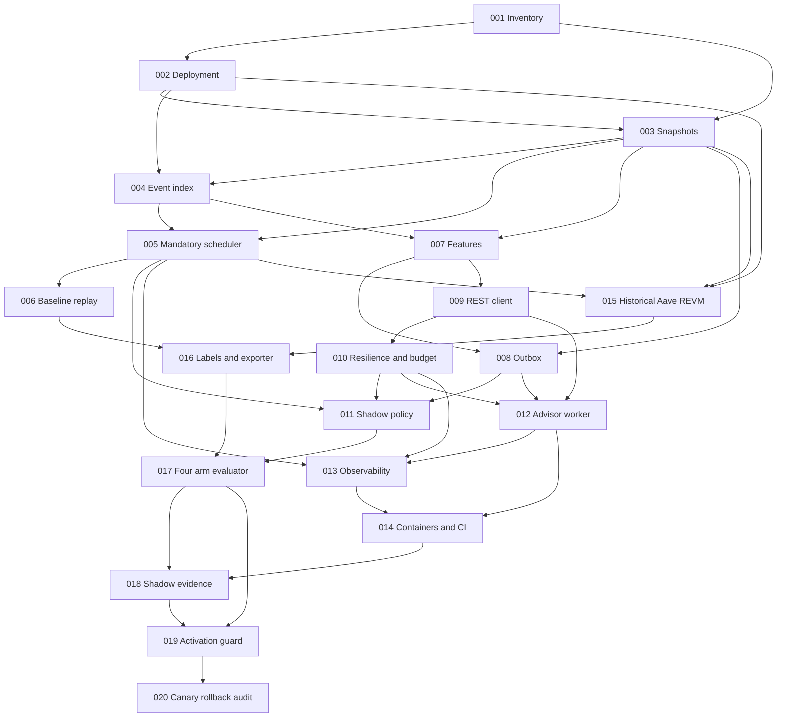

# JEV-LIQ-001 — Audited repository map and measured baseline

Audited 2026-10-13 against **c6f3aa466fb1230424a0dfb41b65e09b5084d72e**, the committed
source selected from the root checkout at task start. Inventory/testing used clean worktree
`/tmp/mev-jev-liq-001-audit`, branch `docs/jev-liq-001-audit`. Both Copper documents
were read in full. Three parallel read-only agents inspected separate ownership areas;
the coordinator verified revisions, source differences, test results and container controls.
This is a documentation/evidence task: no trading behavior, dependencies, infrastructure,
production credentials or deployment configuration changed.

This report supersedes the earlier dirty-tree inventory's baseline claims. Full source
audits, callgraphs, exact references and logs are in
[`docs/audits/evidence/jev-liq-001-2026-10-13/`](../audits/evidence/jev-liq-001-2026-10-13/README.md).
Unqualified source line references below are at c6f3aa4; draft-stack references are marked.
For review, the documentation commit is stacked on `docs/jev-liq-spec` (`acbcb41`);
the measured source remains c6f3aa4. Branch/worktree observations are dated snapshots,
not claims about simultaneous edits by Claude. Claude owns independent verification of
task 006; this task writes only its isolated audit worktree and does not change 006.

## Measured baseline

| Check | Observed result |
|---|---|
| Podman Rust format | exit 0, `cargo fmt --all --check` |
| Podman workspace lint | exit 0, `cargo clippy -q --workspace --all-targets --locked -- -D warnings` |
| Podman locked Rust workspace tests | **564 passed, 0 failed, 24 ignored**, 153 test summaries |
| Podman Foundry format/build | exit 0; Solidity 0.8.28; ArbExecutor runtime 21,376 bytes, AtlasSolver 23,555 bytes |
| Podman network-free Foundry tests | **27 passed, 0 failed, 0 skipped**, 4 suites; invariant 256 runs / 128,000 calls |
| Python audit-guard tests | **3 passed**, exit 0 |
| UI logic / actual Chromium integration | **23 / 17 passed**, 0 failed; SIGTERM flush 3,586 rows / 0 dropped / 0 failed |
| Podman Compose configuration | exit 0; parsed without starting a service |
| Actual Docker engine / Compose | **not verified**: `docker` delegates to Podman; Docker-only config option rejected by podman-compose |

Observed toolchain: rootless Podman **6.1.3**, amd64; container Rust **1.99.0**
(`b940084d7`), Foundry **1.8.4** (`50af4efe189dc64bad2b75ed6990b835de66c4ae`);
host Node **24.18.0**. CI pins Rust 1.99.0 / Foundry 1.8.4 / Node major 22.
The Foundry submodule was initialized at its recorded gitlink
`c6fa5d82a3a287c4ff23f26c8f7e2958aafd32d9`; no dependency upgrade occurred.

**Not run:** the 24 ignored Rust network tests, three Foundry RPC-fork suites, Anvil
live-mode test-bot e2e/crash harnesses, historical Aave/REVM receipt parity, Jev API calls,
live/shadow deployment, or equal-budget historical four-arm comparisons. Green local
tests establish this source baseline, not deployed ABI validity or live readiness.
Last inspected GitHub dependency CI could not start because of account payments/spending
limits; no PRs were merged through red checks.

## Actual workspace and owners

There are **58 Cargo packages / 16 binaries, no Go modules**. The workspace uses Rust
edition 2024, resolver 3, and one component per crate. Main entry points are
`crates/mev-bot/src/main.rs:30`, `crates/seqscope-cli/src/main.rs:1`, decoder/probe tools,
and analytics binaries. The full executable list is in the storage audit.
Locked versions include Alloy 2.5.0, alloy-primitives 1.7.3, REVM 43.0.3, Tokio 1.53.2,
rusqlite 0.40.2 and reqwest 0.13.5 (transitive). Preserve Cargo.lock; manifest ranges
are not exact package pins.

| Responsibility | Existing implementation / call seam | Finding and integration direction |
|---|---|---|
| Sequencer collector | `mev-sequencer/src/lib.rs:37,238,301`; Engine bootstrap `mev-engine/src/lib.rs:617-714` | One shared hash-deduplicated feed fans out to decoder, presim and Runner. Extend this delivery; do not add a collector. DTO lacks canonical block hash/source/event identity. |
| Fast Feed | `mev-ingest/src/fast_feed.rs:46,83,95`; Engine `spawn_fast_feed:3215` | Wire receipt is discarded at decode; Engine further drops tx index, PGA round and sequencer timestamp. Provisional observations cannot be promoted by tx-hash dedupe alone. |
| RPC / chain logs | `mev-ingest/src/lib.rs:24,49`; Engine `ingest_log:1235`, `reconcile_subscription:1273`; `mev-rpc/src/lib.rs:98,122` | Reuse subscriptions, rare-event polling and coherent block/hash reads. AMM continuity/reconciliation exists; borrower canonical lifecycle is separate and missing. |
| Decoder / observed lenders | `mev-decode/src/lib.rs:29`; `events.rs:20`; Engine `on_watched_log:1975` | Lending liquidations are recorded, not used to dirty/recheck borrowers. Existing decoder/dispatch should carry richer envelopes. |
| Aave borrower discovery | `mev-lending-aave-v3/src/lib.rs:81,426`; `mev-lending-index/src/lib.rs:94` | Pool Borrow/onBehalfOf only; numeric forward/backfill JSON cursors, no hash/reorg-safe checkpoint, borrowers never removed. Extend existing index/adapter. |
| Deployment / ABI | `config/arbitrum.toml:54`; `mev-config/src/lib.rs:109`; `mev-bindings/src/lib.rs:91` | Baseline uses configured addresses and local ABI subsets directly. They are not verified chain facts. Task 002 must validate provider resolution/code/rules. |
| Borrower state / eligibility | `mev-lending/src/lib.rs:29,38`; Aave `health:445`, `refresh_snapshot:343`, `predict:486` | Health/debt/collateral are f64; eligibility uses HF<1.0. Mutable prediction cache has no per-account canonical snapshot/CAS. Do not export it as verified canonical state. |
| Market caches / routing | `mev-state/src/lib.rs:52,188,641`; `mev-discovery/src/lib.rs:418`; Engine `find_route:1405` | PoolStore already owns AMM versions/tentative backups and coherent refresh. Preserve it; it is not a borrower repository. Remote fallback route discovery remains in handler. |
| Oracle dependencies | `mev-oracle/src/lib.rs:27,104,174,218`; Aave `affected:508` | Reuse feed resolution/matching and exposure masks. Startup metadata and at-risk-only filtering do not establish complete reverse active-borrower invalidation. |
| Liquidation scheduler | `mev-liquidate/src/lib.rs:237,269,341,404,492` | Existing Runner owns index/sweep/fallback/feed bursts; awaited RPC delays its select loop. Timers/cooldowns are not durable P0/P1 quotas or maximum-age deadlines. |
| REVM | `mev-localsim/src/lib.rs:208,213,335`; `worker.rs:250` | Simulates incoming feed transactions into pool logs, with RPC cache-miss fallback and permissive synthetic context. It does not simulate our final liquidation call. Extend this state/execution owner. |
| Liquidation simulation | `mev-sim/src/lib.rs:107`; Engine `on_plan:2823`, `:2835,2928`; `batch.rs:182` | Executor eth_call + estimate_gas at latest, not liquidation REVM. Simulated minProfit=0 differs from final submitted floor; backrun bypasses simulation. Exact final-call/state binding remains required. |
| Executor / money guards | `mev-exec/src/lib.rs:188,251,270`; `nonce.rs:19`; `mev-risk/src/ledger.rs:310`; `contracts/src/ArbExecutor.sol:255,350,403` | Preserve reservations, final state/STOP/confidence checks, durable attach, original nonce, receipt reconciliation, authenticated callbacks, approval reset and onchain repayment/profit guards. Advisor must not gain access. |
| Persistence | risk `persist.rs:21`, `ledger.rs:133`; lending-index `lib.rs:42,191`; seqscope-store `lib.rs:43` | Durable integer risk ledger, JSON discovery caches, async JSONL diagnostics, SQLite decoded-tx store. No Postgres, SQLx, Redis or transactional advisor outbox in baseline. |
| Metrics / tests / containers | `mev-metrics/src/lib.rs:20,119`; `.github/workflows/ci.yml:43-100`; `scripts/dev.sh:9`; `compose.yaml:13` | Bounded async JSONL/heartbeat exist; no Prometheus/OTel advisor metrics. Runtime is rootless, read-only, caps dropped, shadow default. Docker parity/advisor permission isolation are future acceptance work. |

All Rust owner paths above are under `crates/`. Full exact callgraphs are attached in
the three audit reports; address-book observations were not represented as onchain verification.

```text
mev-bot -> Engine::bootstrap
  -> existing sequencer/Fast Feed fan-out -> Runner::run
  -> AaveV3Adapter -> EventIndex::step -> accounts/health -> sweep/poll -> Plan
  -> Engine::on_plan -> liq_precheck -> deployed-executor eth_call/estimate_gas
  -> risk admission + final profit floor -> Sender -> guarded sign/broadcast -> receipt ledger

incoming feed -> existing REVM worker -> presim pool logs -> PoolStore
canonical AMM logs -> Continuity + coherent refresh -> PoolStore
                         (neither branch currently hydrates canonical borrower snapshots)
```

## Branch reconciliation: available code is not accepted integration

The root baseline c6f3aa4 and main `968d580` have divergent histories but only **five
source / four document** content differences: decoder registry; Engine/lib and Trigger;
Fluid DEX identity; arbitrage diagnostic `simulate_fast_at`; and Copper/coverage/inventory
docs. Their merge-base is `390c292`. Existing audit safeguards must not be called absent
based on commit ancestry alone. Task 001 made no trading-source changes; its comparisons
describe pinned revisions.

| Existing main-based draft | Observed status; next audit requirement |
|---|---|
| 002 / PR #122, `91cca68` | Deployment verifier really runs at startup; live fails, shadow warns. Complete onchain/ABI/rule acceptance still requires independent evidence. |
| 003 / PR #123, `7113cf8` | Exact aggregate snapshot + SQLite CAS/recheck library exists. No engine hydration/worker; reserve balances empty, bitmap/eMode absent from snapshot DTO. |
| 004 / PR #124, `a6fc04b` | Legacy EventIndex hardening is wired. Rich Aave trigger/dependency API exists but Engine never attaches it; token/configuration event completeness remains open. |
| 007 / PR #125, `830a03e` | Feature library exists; availability is not proof its inputs are canonical on the active engine path. |
| 005 / PR #126, `d0f7b52` | Pure mandatory policy + optional disabled shadow pass exists. Engine never attaches it; proposed jobs are recorded, not executed by a rechecker. |
| 006 / draft PR #127, `4149baf` + `cc44844` | Offline runner/tests and synthetic model evidence exist. They do not establish historical actionable recall, live coverage or Jev benefit. |
| 008 / `feat/liq-outbox` | Uncommitted two-file SQLite outbox WIP; not accepted task completion. Non-atomic snapshot/decision CAS and database-role limitations are documented by its author. |
| 009 / `feat/liq-jev-client` | Uncommitted client/fixture WIP; official response provenance, error/deadline acceptance and isolation require verification. |

Reuse existing draft repositories, trigger APIs, policy, features and replay rather than
creating duplicate services. Review/fix each task in its own context and branch. **Do not
infer acceptance from a commit, branch name or passing pure-library test.**

## Readiness and specification decisions

1. **Exact canonical state (003/004):** f64 eligibility, mixed latest reads, incomplete
   position fields and unwired recheck/CAS/checkpoint/reorg lifecycle block truthful features.
2. **Mandatory dispatch (005):** preserve every urgent/sweep event and enforce budgets,
   deadlines and restart/lease recovery through Runner. A hypothetical job list is insufficient.
3. **Final-call economics (015):** consolidate final calldata/state identity through existing
   simulator/executor seams; prove REVM/provider parity, protocol rules and conservative net
   economics. Do not waive this because onchain minProfit still guards repayment.
4. **Persistence (003/008/012):** the supplied specification requires PostgreSQL 16+, atomic
   state+enqueue, claim leases and separate DB roles. The committed SQLite snapshots and
   two-file outbox proposal are an unapproved design deviation, not equivalent evidence.
   Follow the specified Postgres contract unless the owner explicitly amends it; preserve
   interfaces and plan a verified migration instead of introducing a parallel canonical store.
5. **No invented baseline gains (006/016/017):** live per-account timestamps, historical
   ground truth and equal RPC/CPU-budget four-arm comparison are absent. Counts above are
   actual tests; existing replay latencies are explicitly modeled synthetic results.
6. **Operations (014/018-020):** true Docker compatibility, advisor storage permissions,
   graceful recovery, shadow evidence, calibration and explicit activation remain gates.
   Jev cannot change P0/P1, eligibility, profitability, signing or transaction submission.

## Dependency-aware 20-task sequence

Task 001 is complete as an audited inventory/baseline. Existing tasks 002–009 are reviewed
as candidates for reuse; their missing gates must be closed before dependent work is accepted.
Next independent context is **002 deployment/ABI verification**, then 003 exact snapshots
and 004 event completeness. Parallelism is permitted only after the declared dependencies
settle and owners have non-overlapping files.



## Reproduce baseline

Run these commands in a checkout of **c6f3aa4**, not the documentation PR's review tip.

```bash
git submodule update --init --recursive
scripts/dev.sh cargo fmt --all --check
scripts/dev.sh cargo clippy -q --workspace --all-targets --locked -- -D warnings
scripts/dev.sh cargo test -q --workspace --locked
python3 -m unittest discover -s scripts/tests
scripts/dev.sh bash -c "cd contracts && forge fmt --check && forge build --sizes && forge test --no-match-path 'test/{ArbExecutor,UniswapV4,FastFeedTicketVault}.t.sol'"
scripts/test-seqscope-ui.sh
podman-compose -f compose.yaml config
```

The runtime bot was never started by task 001. Only an offline seqscope replay server
was started and cleanly stopped by its existing integration harness. No secrets were read
by the auditors; the dev helper in this clean checkout had no .env file to forward.
Dependency changes: none. Infra changes: none. Rollback: remove these documentation/evidence
files. Test/data-store races are not certified by an inventory: production concurrency,
lease/CAS contention, canonical reorg/provider failures and historical parity require their
task-specific integration tests before acceptance.
